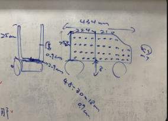
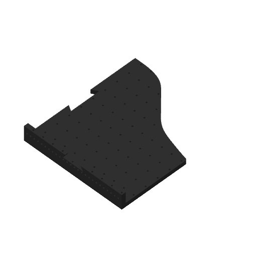
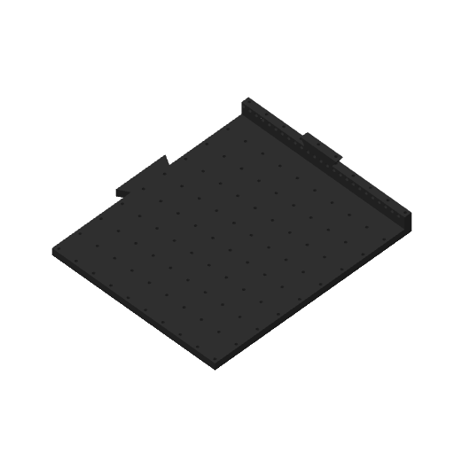
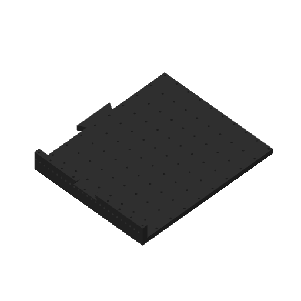

# Bot side panels — cut v1

**Recorded:** 2026-10-24 · **Status:** supplied design baseline; printing and fit tests unrecorded.

The robot side panel is larger than an individual print area, so the supplied design is separated into smaller printable pieces. Kyle supplied the concept sketch and `cut.3mf` as the first FTC build record. The project contains four pieces on four plates. Required panel count, joining method and assembly test results are still unrecorded.

## Files and design evidence

- [Download the original cut.3mf](source/cut.3mf) — preserved byte-for-byte, including its original plate layout and settings.
- [Concept sketch](evidence/side-panel-sketch.png) — original supplied image; handwritten dimensions have not been validated against the mesh.
- [Source inspection](source-inspection.json) — SHA-256, plate mapping, mesh dimensions and embedded settings.

## Supplied plate layout

Dimensions below are the oriented mesh bounding boxes in the saved project, in millimetres. These are geometry measurements, not a dimensional inspection of printed parts.

| Plate | Source part | Oriented X × Y × Z (mm) | Triangles |
|---|---|---|---|
| 1 | Body1_B_B | 223.217 × 254.006 × 33.46 | 37,794 |
| 2 | Body1_A_A | 223.117 × 254.0 × 33.359 | 36,152 |
| 3 | Body1_A_B | 223.117 × 254.0 × 33.459 | 39,858 |
| 4 | Body1_B_A | 223.22 × 254.032 × 33.364 | 34,026 |

| Plate 1 | Plate 2 |
|---|---|
|  |  |

| Plate 3 | Plate 4 |
|---|---|
|  |  |

These previews are extracted from the supplied project, not new slicing or print evidence.

## Embedded printer setup

The original targets **Bambu Lab P2S, 0.6 mm High Flow**, Textured PEI, 0.30 mm layers, 2 walls, 3 top / 3 bottom layers and 15% infill, with support disabled. All four objects select filament slot 1: **Bambu PLA Basic, black**. White and grey PETG profiles are also listed but are not assigned to these objects.

**This is not an H2C-ready project.** Keep this source as the original. The intended H2C material is **Bambu PETG Basic**, confirmed by Kyle on 2026-10-24. The official kit includes right 0.2/0.4/0.6 mm induction hotends and left 0.4 mm standard hotends; see the [setup record](../../profiles/H2C-SETUP.md). Prepare a separate H2C revision after selecting the hotend and confirming actual mapping, plate and colour. The source has no `different_settings_to_system` field; custom override persistence is unverified. No source settings were repaired or changed during archiving.

## Revision and evidence history

| Revision / recorded date | Change / reason | Evidence | Test result |
|---|---|---|---|
| cut-v1 / 2026-10-24 | Supplied robot side-panel design split into four printable pieces | Original project, concept sketch and four stored previews | Not recorded |

The embedded project title is “FTC Board Cut v1”; its internal creation/modification metadata says 2026-10-21. The archive date above records when it was added to this journal.

## Next experiment and notebook evidence

- Confirm overall dimensions and mounting interfaces against the robot and sketch.
- Record how the four pieces join, then test alignment, joint strength and clearance.
- Prepare an H2C revision and keep its exact settings with the dated print attempt.
- Record fit/function results, failures and the reason for any revision. Add measured mass and print duration when available.

Archive CRC, XML/JSON parsing and triangle indices/counts passed. **Mesh check:** plate 1 (Body1_B_B) has 805 edges shared by four triangles; plate 4 (Body1_B_A) has 667, including after exact-coordinate vertex welding. These fail the two-faces-per-edge manifold criterion and need Studio inspection/repair evaluation before printing. Plates 2 and 3 pass that edge-incidence criterion, which alone does not prove printability. The source was not repaired. Native Studio import, a fresh slice and physical printing were not performed. No print success, assembly strength or notebook entry is claimed.
